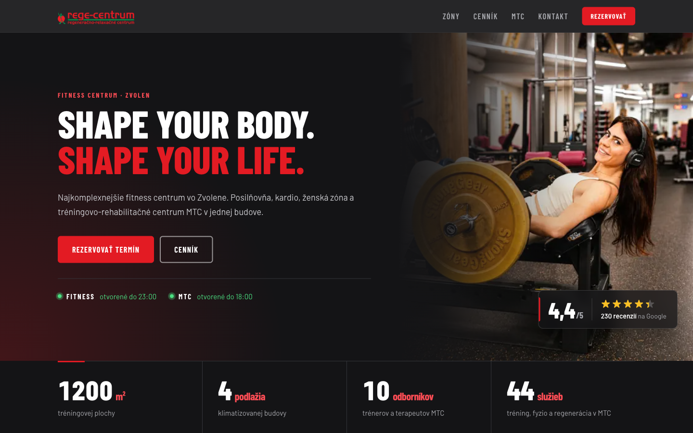
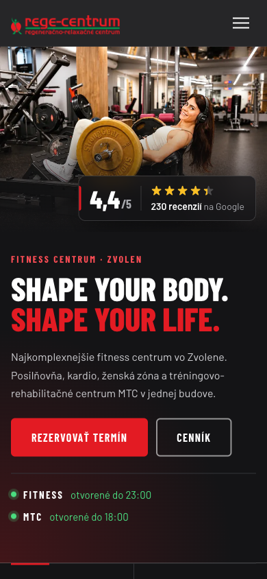
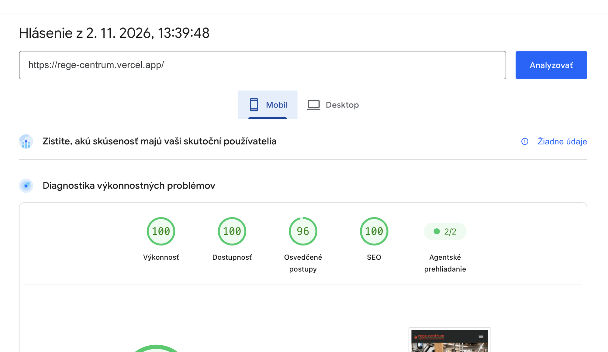
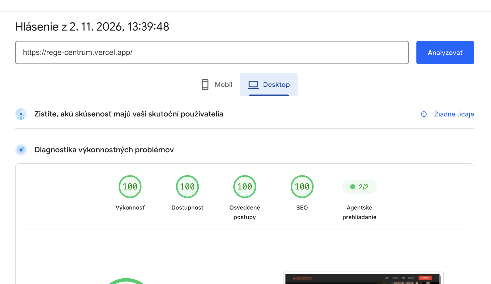

# Rege – Centrum Zvolen · Project Showcase

Full-stack website for a fitness & rehabilitation centre in Zvolen, Slovakia: gym, women's zone and the MTC training-rehabilitation centre — with online booking, card payments and a staff admin panel.

**🔗 Live:** https://rege-centrum.vercel.app

> The source code is in a private repository. **Full source is available on request for hiring purposes** — contact me via my email.

<table>
  <tr>
    <td width="75%"></td>
    <td width="25%"></td>
  </tr>
</table>

## Results — Google PageSpeed Insights

| | Performance | Accessibility | Best Practices | SEO |
|---|:---:|:---:|:---:|:---:|
| 📱 **Mobile** | 🟢 **100** | 🟢 **100** | 🟢 **96** | 🟢 **100** |
| 💻 **Desktop** | 🟢 **100** | 🟢 **100** | 🟢 **100** | 🟢 **100** |

**Before optimisation:** mobile performance 65, accessibility 90.
**What moved the needle:** responsive WebP images (page weight 3 MB → 0.5 MB), build-time pre-rendering of the first screen into HTML, self-hosted subset fonts, CDN caching of read-only API responses, contrast & a11y fixes.

<table>
  <tr>
    <td></td>
    <td></td>
  </tr>
</table>

## Tech stack

| Layer | Technology |
|---|---|
| Frontend | React 18 · TypeScript · Vite · Tailwind CSS v4 |
| Backend | Node.js 22 · Express · TypeScript · Zod validation |
| Database | SQLite via libSQL — local file in dev, [Turso](https://turso.tech) in production |
| Hosting | Vercel — static frontend + API as a serverless function (Dublin region) |
| Payments | Stripe Checkout (cards, Apple Pay, Google Pay) — plain HTTPS, no SDK |
| Quality | Strict TypeScript, API & security tests, CI (audit → typecheck → tests → build) |

## Architecture

```
Browser ──► Vercel CDN ──► static React app (pre-rendered hero, WebP srcset)
   │
   └──► /api/* ──► Express (serverless function)
                     ├── Zod-validated bookings & orders ──► Turso (libSQL)
                     ├── Stripe Checkout + HMAC-verified webhooks
                     ├── Google Places reviews (cached)
                     ├── SMTP e-mails (booking confirmed / cancelled / paid)
                     └── /api/admin/* (Bearer token, brute-force lockout)
```

Shared API types (`shared/types.ts`) are used by both server and client, so a contract change fails the build on both sides.

## Features

- **Online booking** for trainers and therapies; staff confirm or cancel in the admin panel and the client gets an e-mail automatically.
- **Membership passes paid online** — the price is always taken from the server catalogue, never from the browser; a pass counts as paid only after a signed Stripe webhook.
- **Live Google reviews** with the rating shown in the hero.
- **Opening-hours indicator** ("open until 23:00") computed in the centre's time zone.
- **Single-page UX** — the address bar always shows just the domain, yet the browser Back button works.

## Security

- Strict **CSP** (no inline scripts or styles), HSTS, `frame-ancestors 'none'`, nosniff, Referrer- & Permissions-Policy via Helmet.
- Every request validated by a **Zod schema**; 10 kB body limit; parameterised SQL only.
- **Spam protection:** honeypot field (bots get a fake "success"), 20 forms / 10 min per IP.
- **Admin:** constant-time token comparison, IP lockout after 10 failed attempts, server refuses to start in production without a strong token, `no-store` responses.
- No source maps in production; `npm audit` = 0 vulnerabilities.

## Code sample

[`samples/payments.ts`](samples/payments.ts) — Stripe Checkout integration without the SDK: idempotent session creation and webhook signature verification (HMAC-SHA256, constant-time comparison, 5-minute replay window), with injectable `fetch` for testing.

---

© 2026 Juraj Hranický. All rights reserved — see [LICENSE](LICENSE).
